<div align="center">

# JinkyBoard

**Gerçek zamanlı ortak beyaz tahta · ortak kod editörü · sesli/yazılı sohbet · yapay zekâ ile çizim**

Bir odaya 5 haneli kodla (ya da QR ile) girin; aynı sonsuz tuvalde çizin, birlikte kod yazın, konuşun.

**Canlı demo:** <https://ibrahimhyilmaz.github.io/bitirme-projesi/>

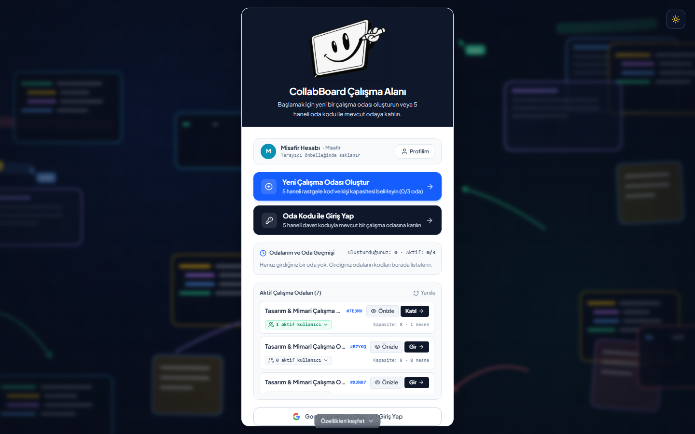

</div>

---

## İçindekiler

- [Özellikler](#özellikler)
- [Son çalışmalar](#son-çalışmalar)
- [Hızlı başlangıç](#hızlı-başlangıç)
- [Yapay zekâ ile çizim kurulumu](#yapay-zekâ-ile-çizim-kurulumu)
- [MCP sunucusu](#mcp-sunucusu)
- [Firebase](#firebase)
- [Yayınlama (GitHub Pages)](#yayınlama-github-pages)
- [Mimari ve dizin yapısı](#mimari-ve-dizin-yapısı)
- [Bilinen sınırlar](#bilinen-sınırlar)

## Özellikler

| Alan | Neler var |
| --- | --- |
| **Tuval** | Sonsuz tahta, serbest kalem / dolma kalem / vurgulayıcı, 60+ şekil, ok ve çizgiler, yapışkan not, metin (Google Fonts), boya kovası, silgi, lazer işaretçi, mini harita, katman ve özellik paneli |
| **Düzenleme** | Şekillerde köşe/uç noktası bazlı düzenleme, gölge, gradyan, köşe yuvarlaklığı, yıldız köşe sayısı, şeklin içine metin |
| **Birlikte çalışma** | Canlı imleçler (renk seçilebilir), roller (kurucu / düzenleyici / izleyici), kurucu odadan çıkıp dönünce yetkisini korur |
| **Kod** | Çok dosyalı ortak editör, dosya başına canlı imleç, tarayıcıda Python (`pip install` dahil) ve JavaScript çalıştırma |
| **Sohbet** | Genel ve özel sohbet, emoji / GIF / dosya, mesaja tepki, okundu bilgisi (gri tek tik → mavi çift tik) |
| **Ses** | Oda içi sesli görüşme (WebRTC) |
| **Yapay zekâ** | Metinden çizim / diyagram; OpenRouter, Groq, Puter, OpenAI, Claude, Gemini ve daha fazlası; anahtarsız çevrimdışı diyagram üretimi |
| **Şablonlar** | Önizlemeli, kategorili hazır panolar (Kanban, SWOT, sprint retrospektifi, mimari şema…) |
| **Katılım** | 5 haneli kod, davet bağlantısı, **QR okutunca doğrudan odaya giriş** |
| **Hesap** | Misafir veya Google ile giriş, profil fotoğrafı, rozetler, arkadaşlık ve oda daveti (Firebase) |
| **Mobil / tablet** | Dokunmatiğe göre tasarlanmış alt çubuk ve alt sayfalar, iki parmakla gezinme/yakınlaştırma, sürüklenebilir çubuklar, ilk girişte animasyonlu rehber |
| **MCP** | Claude Desktop, Claude Code, Cursor gibi istemcilerin tahtaya şekil ve diyagram eklemesi |

## Son çalışmalar

### Birlikte çalışma: senkron, sohbet, okundu bilgisi

Sohbet mesajları artık odaya anında ulaşıyor; gönderen tarafta mesaj tek gri tik ile başlıyor, alıcı sohbeti açınca **mavi çift tik**e dönüyor. Kurucu sayfayı yenilediğinde yetkisini ve okuduğu mesajları kaybetmiyor; aynı kullanıcı odada iki kez görünmüyor. Karşı tarafın imleci kendi seçtiği renkle ve adıyla görünür.

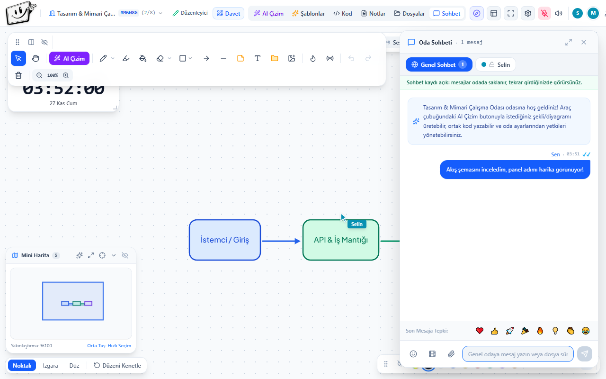

### Ortak kod editörü

Dosya başına ayrı canlı imleç, yeni dosyaların herkese görünmesi ve tarayıcıda çalışan Python/JavaScript terminali.

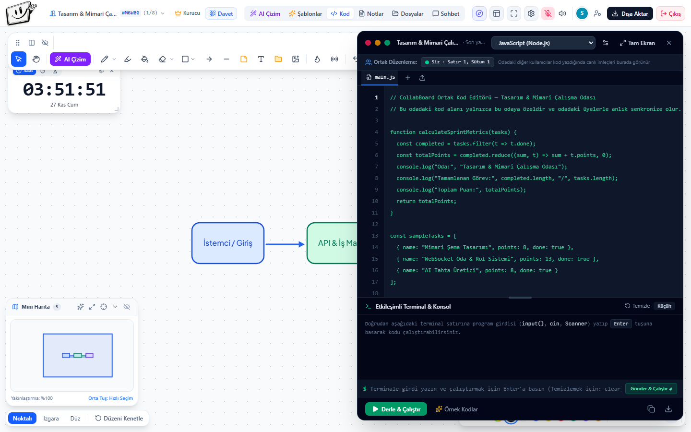

### Şekiller, özellik paneli ve uç noktası düzenleme

Şekil seçilince tuvalin sağındaki dikey sekmelerde (Stil, Şekil, Yazı, Efekt, Düzen) o nesneye ait seçenekler açılır. Çizgi ve oklarda uç noktaları sürükleyerek eğim ve yön değiştirilir; **Çizgi → Noktaları Düzenle** ile köşe bazlı düzenleme açılır.

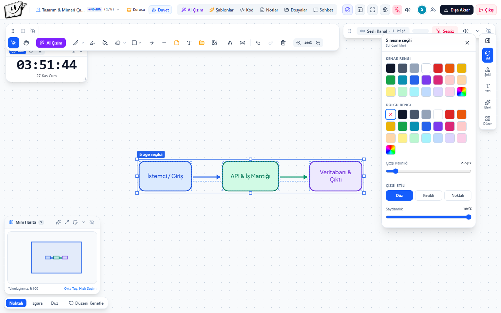

### Hazır şablonlar

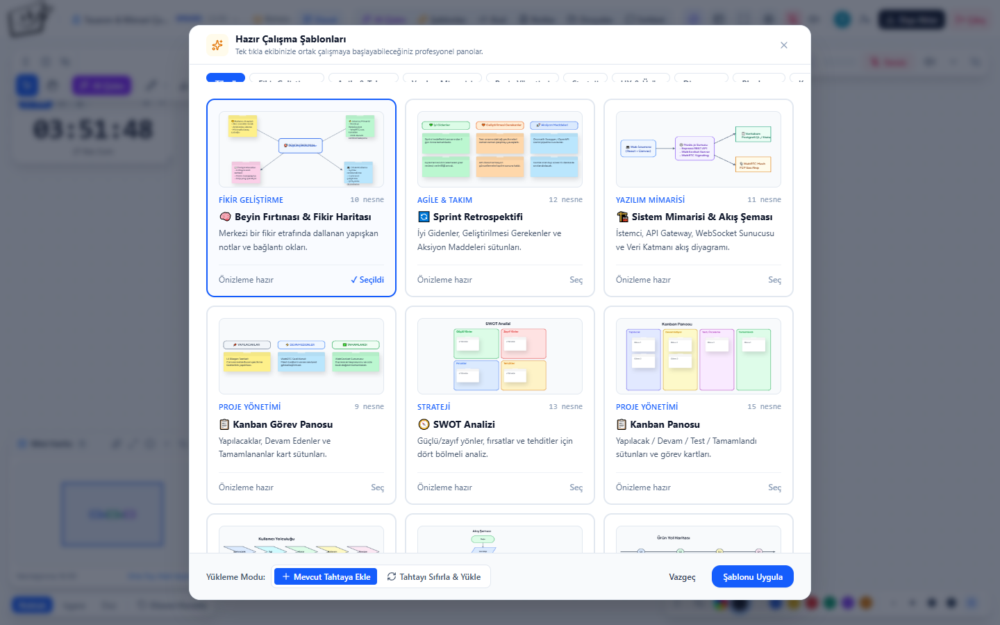

### Yapay zekâ ile çizim

Google tabanlı modeller sorun çıkarınca çizim mimarisi sağlayıcıdan bağımsız hale getirildi. Anahtar gerektirmeyen yollar da var: hazır vektör kütüphanesi ve "giriş, doğrulama, panel" gibi liste biçimindeki isteklerden **anahtarsız, çevrimdışı diyagram üretimi**. Ayrıntılar için [Yapay zekâ ile çizim kurulumu](#yapay-zekâ-ile-çizim-kurulumu).

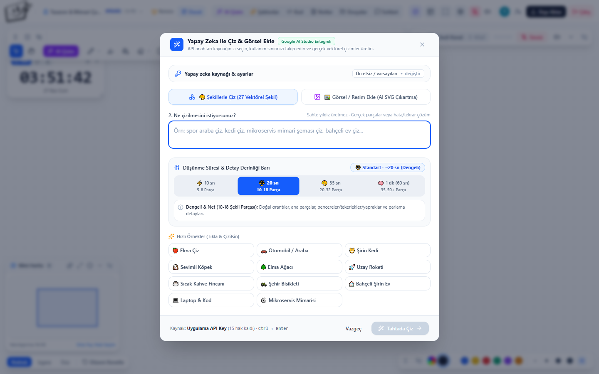

### Tanıtım sayfası: kendiliğinden oynayan demolar

Kaydırmaya bağlı paralaks yerine, her bölümü gösteren **döngüsel animasyonlu demolar** (ortak çizim, ortak kod, ses ve sohbet, PDF ve şablon, yapay zekâ ve davet). Sekmelerle gezilir, kullanıcı denetimi gerektirmez, "hareketi azalt" tercihine saygı duyar.

<p align="center">
  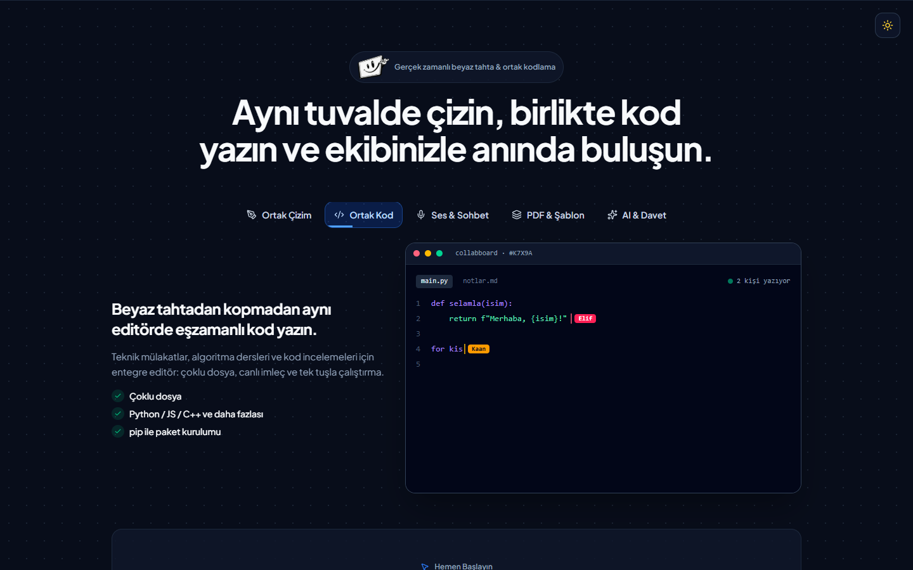
  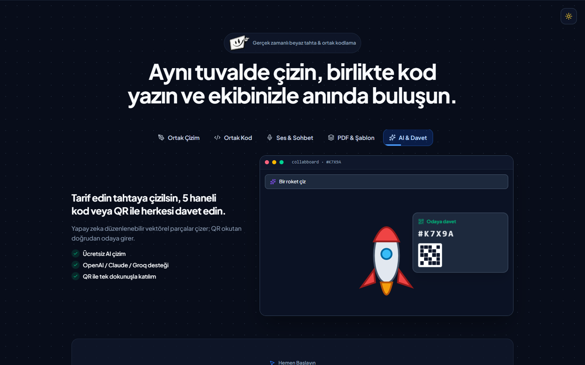
</p>

### Mobil ve tablet deneyimi

Telefonlarda ve dokunmatik tabletlerde araç çubuğu, baş parmağın erişeceği **alt çubuğa** (Seç · Kaydır · Kalem · Şekil · Metin · Silgi · Geri Al · Daha) taşındı. Şekil, silgi ve "Daha" menüleri alt sayfa olarak açılır; çubuk tutamacından sürüklenerek yerinden oynatılabilir.

<p align="center">
  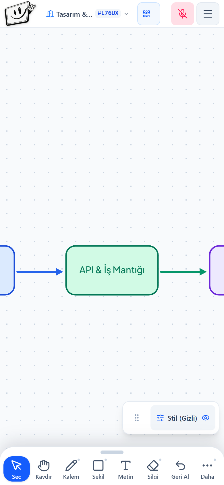
  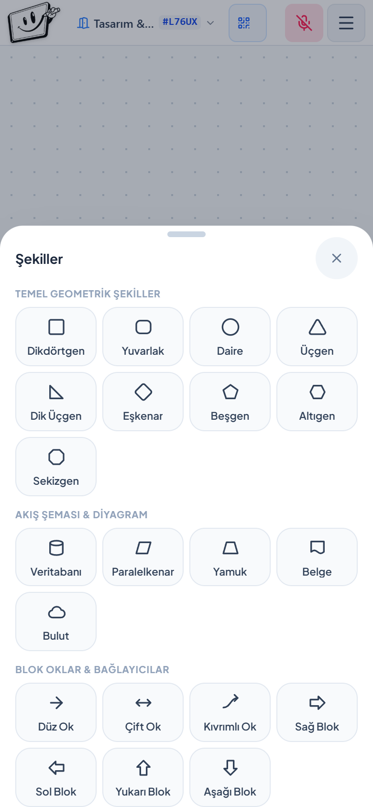
  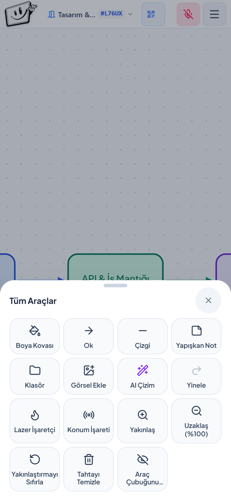
</p>

**İlk giriş rehberi.** QR veya bağlantıyla ilk kez giren kullanıcıya dokunmatik odaklı, animasyonlu bir rehber açılır: tek parmakla çizim, iki parmakla gezinme, kıstırarak yakınlaştırma, **Kaydır (el) aracı** ve davet. Rehber her cihazda üst menüdeki **Tur** düğmesiyle yeniden açılabilir.

<p align="center">
  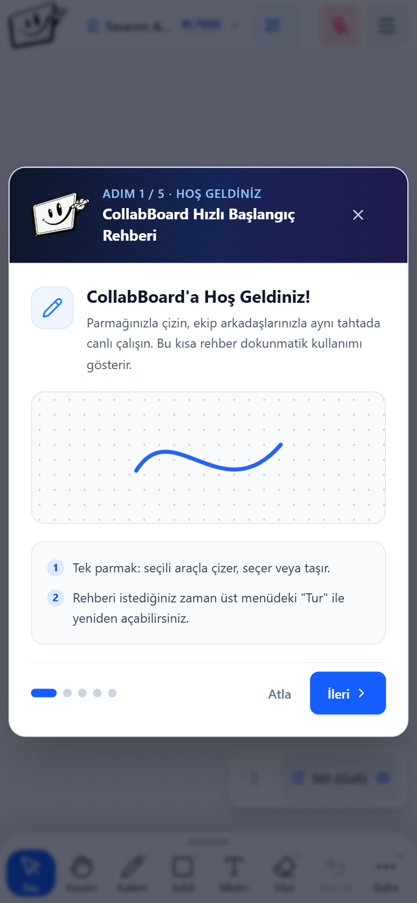
  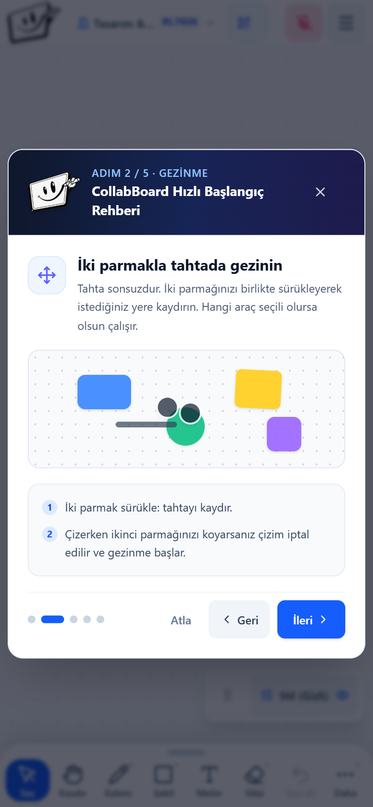
  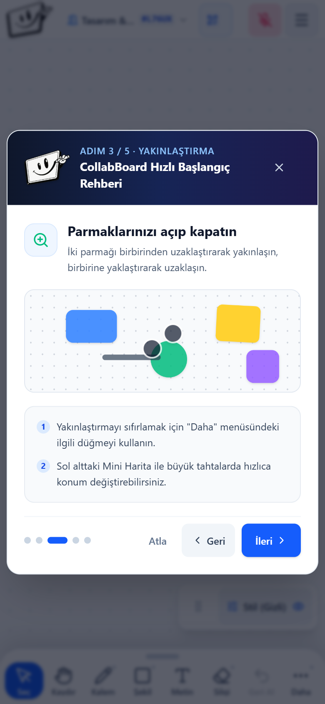
  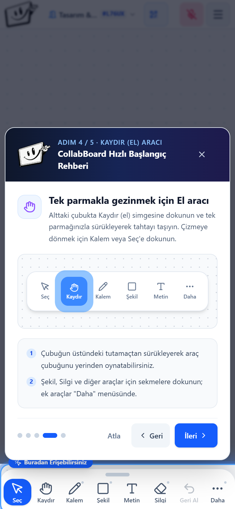
</p>

## Hızlı başlangıç

**Gereksinim:** Node.js 20 veya üzeri. Python çalıştırma tarayıcıda (Pyodide) olur, ek kurulum gerekmez.

```bash
npm install
npm run dev        # http://localhost:3000  (Express + WebSocket + Vite)
```

| Komut | Açıklama |
| --- | --- |
| `npm run dev` | Geliştirme sunucusu (`server.ts`) |
| `npm run build` | Üretim derlemesi (`dist/`) |
| `npm run lint` | Tip denetimi (`tsc --noEmit`) |
| `npm run mcp` | MCP sunucusu (stdio) |

**Ortam değişkenleri** (hepsi isteğe bağlı, `.env.local` içine yazılır):

| Değişken | Ne için |
| --- | --- |
| `GEMINI_API_KEY` | Sunucu tarafı Gemini ile çizim (yoksa diğer sağlayıcılar kullanılır) |
| `PORT` | Üretimde dinlenecek port |
| `TURN_URL`, `TURN_USERNAME`, `TURN_CREDENTIAL` | Zorlu ağlarda sesli görüşme için TURN sunucusu |

> **Önemli:** Gerçek sunucu `server.ts`'tir. `src/server/` altındaki dosyalar kullanılmıyor, değişiklikleri oraya değil `server.ts`'e yapın.

## Yapay zekâ ile çizim kurulumu

GitHub Pages gibi statik barındırmada AI sunucusu olmadığı için sağlayıcıyı tarayıcıdan seçersiniz: **AI Çizim → Yapay zeka kaynağı & ayarlar**.

| Sağlayıcı | Anahtar | Not |
| --- | --- | --- |
| **OpenRouter** | [openrouter.ai/keys](https://openrouter.ai/keys) (ücretsiz, kart gerekmez) | Varsayılan model `openrouter/free`; "Modelleri Listele" ile ücretsiz olanlar öne çıkar |
| **Groq** | [console.groq.com/keys](https://console.groq.com/keys) | Çok hızlı, ücretsiz katman |
| **Puter** | Anahtarsız | İlk kullanımda giriş penceresi açar (deneysel) |
| OpenAI, Claude, DeepSeek, Mistral, Together, Ollama, özel (OpenAI uyumlu) | Kendi anahtarınız | Adres ve model alanları değiştirilebilir |

Sağlayıcı ayarı yalnızca tarayıcınızın `localStorage`'ında tutulur. Model adı emekli olmuşsa (404) uygulama sağlayıcının model listesini isteyip uygun olanla bir kez yeniden dener. Sağlayıcı yoksa: hazır çizim kütüphanesi (elma, araba, kedi, köpek, ağaç, roket, ev…) ve liste biçimli isteklerden çevrimdışı diyagram.

## MCP sunucusu

`mcp/JinkyBoard-mcp.ts`, MCP destekli istemcilerin çalışan bir odaya şekil, diyagram ve çizim göndermesini sağlar (`list_shapes`, `create_diagram`, `create_drawing`, `ai_generate`, `push_to_room`). Kurulum, Claude Desktop yapılandırması ve örnekler: [`mcp/README.md`](mcp/README.md).

## Firebase

Hesaplar, profil, arkadaşlık ve oda davetleri Firebase Auth + Firestore üzerinde tutulur (proje: `collabboard-8dd55`). Kurallar [`firestore.rules`](firestore.rules) dosyasındadır.

> ⚠️ **İstemci ile kurallar birlikte yayınlanmalı.** İstemci profil belgesine `cursorColor` alanını yazar; bu alan yalnızca depodaki kurallarda tanımlıdır. Kurallar Firebase'e yayınlanmadan profil kaydı `permission-denied` verir (eski kurallarla `cursorColor` içeren yazma reddedilir, emülatörde doğrulandı).

```bash
npx firebase login
npx firebase deploy --only firestore:rules --project collabboard-8dd55
```

Kuralları değiştirdikten sonra emülatörde denemek için `npx firebase emulators:exec --only firestore --project demo-test "<test komutu>"` kullanılabilir.

## Yayınlama (GitHub Pages)

`main` dalına her push, [`.github/workflows/deploy-github-pages.yml`](.github/workflows/deploy-github-pages.yml) ile Pages'e yayınlanır. Pages'te Node sunucusu çalışmaz; uygulama **sunucusuz ağ modunda** çalışır: oda iletişimi genel MQTT aracılarıyla, aynı tarayıcıdaki sekmeler `BroadcastChannel` ile, kalıcılık IndexedDB (`JinkyBoard-mesh`) ile sağlanır. Tam özellik (oda listesi, sunucu AI, kalıcı odalar) için `npm run build && npm start` ile kendi sunucunuzda çalıştırın.

## Mimari ve dizin yapısı

```
server.ts               Express + ws: odalar, roller, sohbet, kod dosyaları, imleçler, Vite ara katmanı
src/
  App.tsx               Oda yaşam döngüsü, giriş akışı, panel yerleşimi
  components/           CanvasBoard, Toolbar (masaüstü + mobil dock), PropertiesPanel, VertexEditor,
                        ChatDrawer, CodeEditorPanel, AIPromptModal, OnboardingTour, GestureDemo,
                        LandingShowcase, TemplatesModal, ProfileSocialModal …
  hooks/                useWebSocket (oda bağlantısı/mesh), useAccountSocial (Firebase), useIsMobile
  ai/                   core.ts (sağlayıcıdan bağımsız LLM katmanı), providerStore.ts
  utils/                canvasRenderer, freeAI (çevrimdışı diyagram), extraShapes, pyodideRunner, badges …
mcp/                    MCP sunucusu ve belgeleri
firestore.rules         Firestore güvenlik kuralları
docs/screenshots/       Bu belgedeki ekran görüntüleri
```

Teknoloji: React 19, Vite, Tailwind CSS 4, TypeScript, Express + ws, Firebase, MQTT, Pyodide, pdf.js.

## Bilinen sınırlar

- Gerçek bir dokunmatik cihazda iki parmak hareketleri ve alt çubuğun 320 px gibi çok dar ekranlardaki görünümü elle doğrulanmadı.
- Puter sağlayıcısı deneyseldir; anahtarsız Pollinations hizmeti tarayıcıdan kullanılamadığı için (Turnstile) kaldırıldı.
- Tur ve yeni arayüz metinleri henüz tüm dillere çevrilmedi (Türkçe görünür).
